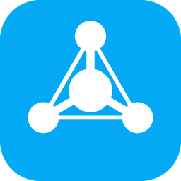

<p align="center">
  
</p>

# Matter Bridge

[](https://hacs.xyz/)
[](https://www.home-assistant.io/)
[](https://github.com/bisman-automations/ha-matter-bridge/releases)
[](https://github.com/bisman-automations/ha-matter-bridge/actions/workflows/test.yml)
[](https://github.com/bisman-automations/ha-matter-bridge/actions/workflows/validate.yml)
[](LICENSE)

Shows [Home Assistant Matter Hub](https://github.com/RiDDiX/home-assistant-matter-hub) as an integration under **Settings → Devices & services**, with a service for Matter Hub and one for each Matter bridge you created in it.

Matter Hub does the Matter work: it publishes your Home Assistant entities to Apple Home, Google Home, Alexa and other Matter controllers. This integration lets you watch and control those bridges from Home Assistant, so you can see bridge status on dashboards, get alerted when a bridge fails, and restart or re-sync a bridge from an automation.

## Requirements

* Home Assistant 2026.8 or newer
* Home Assistant Matter Hub, reachable over the network at its web interface (port 8482 by default). That is the Matter Hub app on Home Assistant OS or Supervised, or Matter Hub in Docker or standalone.

## Installation

Requires **Home Assistant 2026.8 or newer**.

### Marketplace (Home Assistant 2026.11 and newer)

[](https://my.home-assistant.io/redirect/marketplace_repository/?owner=bisman-automations&repository=ha-matter-bridge&category=integration)

1. Select the button above, or go to **Settings > Marketplace**, choose **Add from link**, enter `bisman-automations/ha-matter-bridge` under **GitHub link**, and select **Add**. Adding a repository from a link needs a GitHub connection; the Marketplace asks you to connect one if you haven't.
2. Install **Matter Bridge**. If a repair asks you to restart Home Assistant, restart it.

New versions show up under **Settings > Updates**. Already installed Matter Bridge with HACS? There's nothing to do: Home Assistant moves it into the Marketplace the first time it starts on 2026.11.

### HACS (Home Assistant 2026.10 and older)

[](https://my.home-assistant.io/redirect/hacs_repository/?owner=bisman-automations&repository=ha-matter-bridge&category=integration)

1. Click the button above, or in HACS open the menu, choose **Custom repositories**, and add `https://github.com/bisman-automations/ha-matter-bridge` as an **Integration**.
2. Download **Matter Bridge** and restart Home Assistant.

### Manual

Download `matter_bridge.zip` from the [latest release](https://github.com/bisman-automations/ha-matter-bridge/releases/latest), unzip it into `config/custom_components/matter_bridge/`, and restart Home Assistant.

## Setup

[](https://my.home-assistant.io/redirect/config_flow_start/?domain=matter_bridge)

Or go to **Settings → Devices & services → Add integration → Matter Bridge**.

Setup asks for the address of the Matter Hub web interface.

### Connecting to the Matter Hub app

The app uses the host network. It does not get its own hostname on the Supervisor network, and this integration does not open a Home Assistant ingress session. Unless you changed the port, the web interface is on port **8482**. Enter one of these:

* `http://homeassistant.local:8482`
* the IP address of this Home Assistant, on port 8482, if that name does not resolve

Open the Matter Hub panel in the sidebar if you want to confirm the port. The address above is what you put in the URL field; the panel and the integration are separate.

The app does not publish Supervisor discovery, so the address is entered by hand. The stable, alpha and testing channels of the app all use the same host and port.

### Connecting to Docker or standalone Matter Hub

Enter the web interface address, for example `http://192.0.2.50:8482`.

### Username and password

If you turned on authentication in Matter Hub's settings (or set `HAMH_HTTP_AUTH_USERNAME` / `HAMH_HTTP_AUTH_PASSWORD`), enter the same username and password. If Matter Hub has an IP allow list, add your Home Assistant host to it.

### Setups that used the Matter Hub app connection

Versions before 2.0.0 could connect through Home Assistant ingress. Those setups are not loaded after you update. A repair under **Settings → System → Repairs** asks for the address above and keeps the devices and entities you already have. You can also choose **Reconfigure** on the integration.

## Devices and entities

### Matter Hub

| Entity | Description |
| --- | --- |
| Status | `healthy`, `degraded` (a bridge is stopped or failed) or `unhealthy` (Matter Hub lost its Home Assistant connection) |
| Running bridges | Running bridge count; attributes list total, stopped and failed |
| Home Assistant connection | Whether Matter Hub's own connection to Home Assistant is up |
| Uptime | Seconds since Matter Hub started (disabled by default) |
| Restart all bridges | Restarts every bridge |

### Each bridge

| Entity | Description |
| --- | --- |
| Status | `starting`, `running`, `stopped` or `failed`, with the failure reason as an attribute |
| Running | Switch that starts or stops the bridge |
| Devices | Matter devices the bridge exposes |
| Controllers | Paired controllers (fabrics), with their names as an attribute |
| Commissioned | On once a controller has paired |
| Failed entities | Entities Matter Hub could not expose, with the reasons as an attribute |
| Restart, Refresh devices, Force sync | Bridge actions from the Matter Hub UI |
| Open pairing window | Asks Matter Hub to let another controller pair with an already commissioned bridge |

Bridges you add in Matter Hub appear automatically. A bridge you delete is removed after three successful updates that leave it out (about a minute and a half). An update that cannot reach Matter Hub does not count. If you create that bridge again later, its entities come back.

To create bridges, change which entities they expose, or read a pairing code, use the Matter Hub web interface. The Matter Hub and bridge services have a **Visit** link that opens it. Home Assistant does not show the manual pairing code or the QR code: anyone who can read a state could otherwise add the bridge to their own controller.

## Example automation

```yaml
automation:
  - alias: "Restart a failed Matter bridge"
    triggers:
      - trigger: state
        entity_id: sensor.living_room_status
        to: failed
        for: "00:02:00"
    actions:
      - action: button.press
        target:
          entity_id: button.living_room_restart
```

## Diagnostics

Download diagnostics from the integration page. Pairing codes, QR payloads, passcodes, discriminators, fabric and node IDs, the Matter Hub URL and credentials are removed. A QR payload is removed even if Matter Hub adds it under a new name.

## Troubleshooting

* **Repair says Matter Bridge needs a URL**: this setup used the old app connection. Enter the Matter Hub address in the repair (for the app, usually `http://homeassistant.local:8482`). The devices and entities stay.
* **Failed to connect**: check the address opens the Matter Hub web interface in a browser on the same network as Home Assistant. For the app, confirm it is started and that you are using port 8482, or the port you set.
* **A bridge you deleted in Matter Hub is still listed**: its service is removed after about a minute and a half, once Matter Hub has left it out of three successful updates in a row. An update that fails does not count.
* **A bridge you added again has no entities**: they come back on the next update after the old service was removed. Give it a couple of minutes.
* **Asked for a username and password after setup**: authentication was turned on in Matter Hub. Enter the same credentials in the repair prompt.
* **Where is the pairing code?**: open Matter Hub with the **Visit** link on the Matter Hub or bridge service, and read the code there. It is not an entity in Home Assistant. Don't share it.

### Diagnostics and debug logs

When something goes wrong, download diagnostics from **Settings → Devices & services → Matter Bridge → ⋮ → Download diagnostics** and check the file before you share it.

For debug logs, use **Enable debug logging** on the integration page, or add this to `configuration.yaml` and restart:

```yaml
logger:
  logs:
    custom_components.matter_bridge: debug
```

Then open an [issue](https://github.com/bisman-automations/ha-matter-bridge/issues/new/choose) with the diagnostics, the log, and your Home Assistant and Matter Bridge versions.

Never post a bridge's pairing code or QR code in an issue: anyone with it can add the bridge to their own Matter controller.

## Development

Tests run inside a real Home Assistant through
[pytest-homeassistant-custom-component](https://github.com/MatthewFlamm/pytest-homeassistant-custom-component).
You need Python 3.14 for the current Home Assistant.

```bash
python3.14 -m venv .venv && . .venv/bin/activate
pip install -r requirements_test.txt
ruff check . && ruff format --check .
pytest
```

To test against the oldest supported Home Assistant (2026.8), use Python 3.14 and
`pip install -r requirements_test_min.txt` instead.

CI runs the same checks on every push and pull request, on both Home Assistant
versions, plus hassfest, HACS validation and the shared repo standards, using the
workflows in [bisman-automations/.github](https://github.com/bisman-automations/.github).
Releases are drafted from [CHANGELOG.md](CHANGELOG.md); see [CLAUDE.md](CLAUDE.md).

## License

Apache-2.0. See [LICENSE](LICENSE).

Not affiliated with the Home Assistant Matter Hub project.
